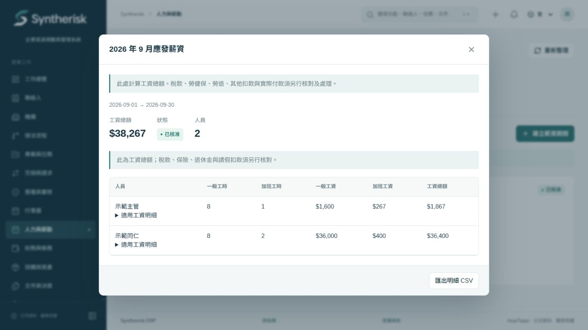

# Syntherisk ERP

開源、可自行部署的 ERP，提供客戶與專案管理、任務確認、內部協作、財務流程，以及台灣排班、出勤打卡與應發薪資計算。

**商業模式：一次性導入費 + 每月維護服務費。** 停止維護服務後，客戶可繼續使用已部署版本；系統沒有到期鎖定、遠端停用或強制訂閱檢查。

This is a self-hosted ERP with Taiwan workforce operations. The software remains usable without a support subscription. Version **0.1.0** is an initial open-source product release; validate your own payroll policies and deployment before processing live wages.



## 功能

- CRM、專案、里程碑、任務、來源紀錄、確認備註及操作歷史。
- 交辦、審核、公告、電子確認、文件及團隊工作區。
- 請購、費用、發票、收付款與財務工作台。
- **排班**：行事曆／清單切換、依日期新增與查看班次、跨日班次顯示、員工啟用、班次草稿／發布／取消、重疊檢查及出勤日類型。
- **出勤**：本人上下班打卡、休息開始／結束、伺服器時間、主管修正原因及核准紀錄。
- **薪資**：生效日薪資設定、時薪／完整月薪、台灣平日及休息日加班分段計算、核准後鎖定及 CSV 匯出。
- 工作區／公司權限、本人薪資可見範圍、稽核及備份工具。

薪資模組計算的是**應發總額**；不會匯款，也不自動申報扣繳或計算勞健保。特殊假日、變形工時及未支援的情境會要求人工處理，不應以一般日代算。詳細範圍見 [台灣薪資規則](docs/TAIWAN_PAYROLL.md)。

## 快速開始

需要 Node.js 24、pnpm 11；使用容器部署時另需 Docker Compose。開發版使用專用 PostgreSQL 連接埠 `55434`、網站 `3030`，不依賴任何既有公司安裝。

```sh
git clone https://github.com/annawang12282007/syntherisk-erp.git
cd syntherisk-erp
pnpm install --frozen-lockfile
pnpm run setup
pnpm db:start
```

保持資料庫終端機開啟，在另一個終端機執行：

```sh
pnpm db:migrate
# 設定 ADMIN_EMAIL、ADMIN_NAME、ADMIN_PASSWORD、WORKSPACE_NAME 後：
pnpm admin
pnpm dev
```

在第三個終端機執行 `pnpm worker`。瀏覽 `http://localhost:3030`。首次登入管理員必須更新密碼。沒有預設管理員帳密；`pnpm run setup` 只產生本機隨機環境金鑰。

Docker、Windows 管理員初始化、HTTPS、備份及更新步驟見 [部署指南](docs/DEPLOYMENT.md)。正式環境請使用空白資料庫、客戶自己的網域與整合帳號，先在測試環境驗證。

## 開發與驗證

匯出測試使用 Python 3.12 的獨立 XLSX／PDF 讀取套件。先在 Python 虛擬環境安裝鎖定版本：`python -m pip install -r requirements-test.txt`；若使用非預設 Python，將 `QA_PYTHON` 設為該直譯器的完整路徑。Python 僅用於測試，執行 ERP 不需要它。

```sh
pnpm typecheck
pnpm test:node
pnpm test:isolated
pnpm build
pnpm release:check
```

`test:isolated` 需要正在執行且允許建立測試資料庫的 PostgreSQL，會建立隨機資料庫、套用全部 migrations 並於結束刪除該測試資料庫。它不會對設定中的業務資料庫執行業務測試。瀏覽器驗收亦使用獨立合成資料；相關檔案不應公開。

## 開源與服務

程式依 [GNU AGPL-3.0-only](LICENSE) 發布，允許商用、導入收費及維護服務。修改後透過網路提供服務時，須向該服務的使用者提供相應原始碼；客戶的帳務、薪資及私人資料不因此成為公開內容。

- [商業與維護模式](docs/BUSINESS_MODEL.md)：導入交付、月費服務、終止服務及代管邊界。
- [安全政策](SECURITY.md)：部署責任及弱點回報。
- [貢獻指南](CONTRIBUTING.md)：測試、授權及不攜入業務資料。
- [第三方套件資訊](docs/THIRD_PARTY.json)：依鎖定版本產生的授權清單。

本專案是獨立產品原始碼，未包含公司資料庫、帳號、金鑰、郵件、附件、SSH 連線資訊或既有正式環境部署設定。
